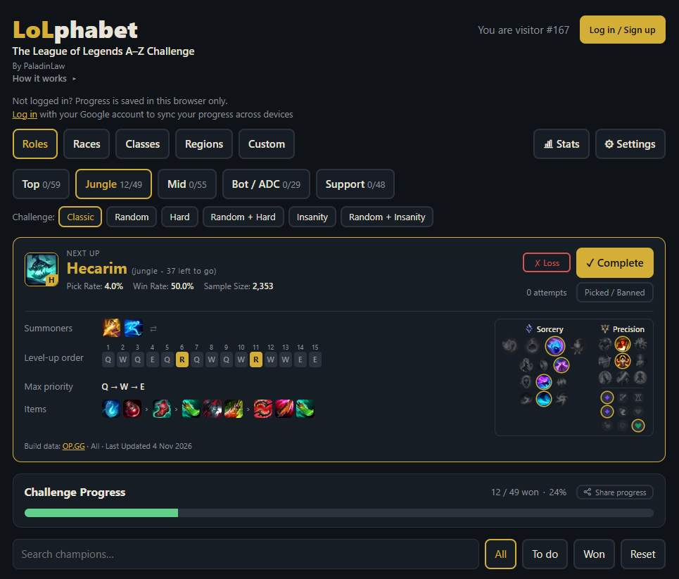

# LoLphabet

**The League of Legends A–Z Challenge tracker.** Work through the champion roster alphabetically, win a game with every champion, and keep track of it all in one place.

Live site: **[https://lolphabet.app](https://lolphabet.app)**



## What it does

- **Role lists and custom lists.** Top, Jungle, Mid, Bot and Support lists, plus your own custom champion lists.
- **Six challenge modes.**
  - **Classic:** alphabetical, any order.
  - **Random:** a fixed shuffled order.
  - **Hard:** only the next champion can be played, and a loss sends you back **one** champion.
  - **Random + Hard:** the same rule on a shuffled order.
  - **Insanity:** a loss sends you back to the start of the run.
  - **Random + Insanity:** shuffled order, restart on loss.
- **Next Up banner** with pick rate, win rate and sample size, plus a suggested build:
  - summoner spells (Flash on the right by default, with a swap button),
  - skill order,
  - items in a single row (starting, boots, core, situational),
  - a collapsible rune page that highlights the recommended runes and shards.
- **Picked / Banned** button to set a champion aside without counting a loss.
- Progress stats, editable win dates and notes, search and filters, and a share-image button.
- Google sign-in so progress syncs between devices. No ads.

## How it's built

LoLphabet consists of two components:

| Folder | Purpose |
| --- | --- |
| [`lol-az-tracker/`](lol-az-tracker) | The web app: a dependency-free Node server (`server.js`) and a single-file front end (`index.html`). |
| [`lol-meta-collector/`](lol-meta-collector) | An optional Python/Docker pipeline that collects champion analysis and suggested builds from OP.GG and resolves game assets against Riot Data Dragon. |

The collector writes JSON and CSV files to a shared data directory. The tracker mounts that directory read-only and uses the generated data for the Next Up build display. The tracker works without the collector; builds simply won't be available in the Next Up banner.

## Deployment with Docker Compose

Both services have a `docker-compose.yml` that can be deployed independently. The Compose files are suitable for a public Git repository: host-specific paths and deployment settings are configurable through environment variables rather than being hard-coded into the files.

### 1. LoLphabet tracker

The tracker listens on `127.0.0.1:3081` by default. Put a reverse proxy (Caddy, Nginx, Cloudflare Tunnel, etc.) in front of it for public access.

For a manual deployment:

```bash
cd lol-az-tracker
docker compose up -d
```

The `GOOGLE_CLIENT_ID` variable is required by the supplied Compose file. Set it in your shell or in a local `.env` file before running Compose. Do not commit a `.env` file containing private deployment settings.

Without Docker, the server can be run directly with Node 18+:

```bash
cd lol-az-tracker/app
GOOGLE_CLIENT_ID=your-id.apps.googleusercontent.com node server.js
```

The server has no npm dependencies. Without a `GOOGLE_CLIENT_ID`, it can still run, but Google sign-in is disabled and progress stays in the browser.

### 2. LoL Meta Collector (optional)

The collector fetches suggested builds and writes them to the shared data directory. It is only needed for the builds shown in the Next Up banner.

Before starting the collector, ensure that its private `config.json` exists at the configured host path. The default is `/opt/docker/lol-meta-collector/config.json`.

Build the image and verify the live OP.GG MCP schema and a single champion/role before starting the scheduler:

```bash
cd lol-meta-collector
docker compose build
docker compose run --rm --entrypoint python lol-meta-collector -m lolmeta inspect
docker compose run --rm --entrypoint python lol-meta-collector -m lolmeta probe --champion Ahri --position mid
```

If the probe succeeds, start the weekly scheduler:

```bash
docker compose up -d
```

The scheduler performs one collection immediately on first startup, then runs approximately every seven days at 03:15 Africa/Johannesburg time. Its last-run date is persisted in `data/scheduler-last-run.txt`, so container restarts do not normally trigger duplicate weekly runs.

To run a collection manually:

```bash
docker compose run --rm lol-meta-collector python -m lolmeta collect
```

To collect only one champion/role:

```bash
docker compose run --rm lol-meta-collector python -m lolmeta collect --champion Ahri --position mid
```

### 3. Dockhand deployment

For Dockhand Git stacks:

1. Create a Git stack pointing to the LoLphabet repository.
2. Set its Compose file path to `lol-az-tracker/docker-compose.yml`.
3. Configure the tracker variables listed below in that stack's environment settings.
4. Create a second Git stack using `lol-meta-collector/docker-compose.yml`.
5. Configure the collector variables listed below in that stack's environment settings.
6. Ensure `COLLECTOR_DATA_DIR` has exactly the same value in both stacks.
7. Deploy the collector and tracker.

The collector's `build: .` expects the Compose file to be in the same directory as its `Dockerfile`, as it is in this repository.

#### Tracker environment variables

| Variable | Required | Purpose |
| --- | --- | --- | --- |
| `GOOGLE_CLIENT_ID` | **Yes** | Google OAuth client ID used for sign-in. |
| `CONTAINER_NAME` | No | Docker container name. |
| `BIND_IP` | No | Host IP on which the tracker port is published. Keep this at loopback when a reverse proxy runs on the same host. |
| `HOST_PORT` | No | Host-side published port. |
| `APP_PORT` | No | Port the Node application listens on inside the container. |
| `TRACKER_APP_DIR` | No | Host directory containing `index.html`, `server.js` and `assets/`. |
| `TRACKER_DATA_DIR` | No | Persistent host directory for accounts and progress. Back this directory up. |
| `COLLECTOR_DATA_DIR` | No | Shared host directory containing collector output. Must match the collector stack's value. |
| `CONTACT_EMAIL` | No | Contact address shown on the privacy and terms pages. |
| `SITE_URL` | No | Public site URL used for canonical links and metadata. |

The Compose file sets these application environment variables internally:

| Variable | Value | Purpose |
| --- | --- | --- |
| `DATA_FILE` | `/data/data.json` | Location of account and progress data inside the container. |
| `COLLECTOR_DIR` | `/collector` | Read-only collector output mount inside the container. |

Other application settings documented by the tracker include:

| Variable | Default | Purpose |
| --- | --- | --- |
| `BUILD_STALE_DAYS` | `14` | After this many days, build data is flagged as stale. |
| `ROLES_URL` | Meraki Analytics champion data | Source for the role lists. |

To get a Google client ID, create an OAuth client in the [Google Cloud Console](https://console.cloud.google.com/apis/credentials) and add your site's URL as an authorised JavaScript origin.

#### Collector environment variables

| Variable | Required | Purpose |
| --- | --- | --- | --- |
| `COLLECTOR_CONTAINER_NAME` | No | Docker container name. |
| `COLLECTOR_DATA_DIR` | No | Host directory where the collector writes output. Must match the tracker stack's value. |
| `COLLECTOR_LOG_DIR` | No | Host directory mounted for collector logs. |
| `COLLECTOR_CONFIG_FILE` | No | Host path to the private, read-only collector configuration file. |
| `COLLECTION_INTERVAL_DAYS` | No | `7` | Scheduler interval in days. |
| `TZ` | No | `Africa/Johannesburg` | Time zone used by the scheduler. |

Dockhand supplies these variables to Compose when deploying each stack. Variables are configured per stack, so add `COLLECTOR_DATA_DIR` to both stacks and keep the values identical. `GOOGLE_CLIENT_ID` is the only required Compose variable; the other variables have defaults.

Do not commit private `.env` files, collector `config.json`, account/progress data, logs, or generated collector output to the public repository. The Compose files contain defaults for a typical deployment, but you can override them in Dockhand for your host.

### Running without Dockhand

For a local/manual Compose deployment, create a local `.env` file in the relevant Compose directory or export the variables in your shell. Keep that file out of Git. For example, the tracker requires:

```dotenv
GOOGLE_CLIENT_ID=your-id.apps.googleusercontent.com
```

The remaining variables can use their documented defaults or be added to the local `.env` file as needed.

## LoL Meta Collector

### Data source and API behaviour

The collector is a Python/Docker pipeline that collects League of Legends champion analysis/build data from OP.GG's **published OP.GG MCP server**, resolves game assets against Riot Data Dragon, and writes frontend-ready JSON plus flat CSV exports.

What is verified:

- [`OPGG.py`](https://github.com/ShoobyDoo/OPGG.py) exposes `get_champion_stats()` / `get_champion_stats_async()`. Its docstring says this returns aggregate ranked champion statistics (win/pick/ban etc.). Its implementation calls the `/champions/ranked` endpoint and returns the response's `data` object. It does **not** document a champion-build endpoint. See its [`opgg/opgg.py` source](https://github.com/ShoobyDoo/OPGG.py).
- OP.GG's official [MCP server](https://github.com/opgginc/opgg-mcp) documents `lol_get_champion_analysis` as returning champion win/pick/ban stats, optimal builds, items, runes, skills and spells. It documents the Streamable HTTP endpoint `https://mcp-api.op.gg/mcp`.
- The MCP server's published README does not document a bulk-export API, tier/rank filter, patch parameter, or rate limit. The collector therefore discovers the live tool schema at runtime and only sends arguments accepted by that schema. It does not claim to filter by Emerald+ unless the live schema supports it.

Run `inspect` and `probe` on your own server before starting a full collection. The collector saves the live tool schema and raw payloads so unsupported or changed fields are visible rather than silently fabricated.

### Requirements

- Docker (recommended), or Python 3.12+.
- Outbound HTTPS access to `mcp-api.op.gg` and `ddragon.leagueoflegends.com`.
- No Riot API key is required for the OP.GG MCP data path.

### Local Python setup

```bash
python3.12 -m venv .venv
. .venv/bin/activate
pip install -r requirements.txt
python -m lolmeta inspect
python -m lolmeta probe --champion Ahri --position mid
python -m lolmeta collect --champion Ahri --position mid
python -m lolmeta collect
```

### Collector configuration

The collector reads `config.json`. Keep this file on the host and do not commit it if it contains deployment-specific settings.

| Setting | Purpose |
| --- | --- |
| `positions` | Positions to collect: `top`, `jungle`, `mid`, `adc`, `support`. |
| `game_mode` | Requested game mode. The live MCP schema is checked and enum values are matched before calls. |
| `language` | Language, normally `en_US`. |
| `request_delay_seconds` | Delay between calls (default `0.5` seconds); increase it if OP.GG starts rate-limiting requests. |
| `tier` | Rank filter sent to the live MCP analysis tool when its schema exposes `tier` (default in this package: `all`). |
| `region` | Region for the separate OPGG.py aggregate statistics endpoint (default in this package: `EUW`). The verified OPGG.py implementation accepts `EUW` as a region string even though its `StatsRegion` enum only defines `GLOBAL`. |
| `include_opggpy_aggregate_stats` | Also call OPGG.py's aggregate stats endpoint, separately from the build data. |
| `archive_snapshots` | Retain timestamped snapshots. |

The MCP build-analysis tool supports an all-ranks tier request. Its currently inspected schema has no region argument, so build data is not labelled as EUW-specific. The OPGG.py aggregate statistics export is configured separately for EUW + all ranks.

Important: OPGG.py's documented aggregate stats API has tier/queue/version controls but returns champion statistics, not build runes/items/skill order. The complete build payload is requested from OP.GG's official MCP `lol_get_champion_analysis` tool.

### Collector output

```text
data/
├── cache/                          # Cached Data Dragon champion roster
├── current/
│   ├── champions.json              # Complete raw + projected records
│   ├── champion_builds.csv         # Flat champion/role/statistics export
│   ├── metadata.json               # Patch, collection timestamp, counts, failures
│   ├── failures.json               # Per-champion/role errors
│   ├── mcp-tool-schema.json        # Live input schema for champion analysis
│   ├── opggpy-aggregate-stats.json # Optional aggregate stats from OPGG.py
│   └── champions/<champion>-<role>.json
└── archive/<patch>-<timestamp>/    # Historical snapshots
```

Each per-champion JSON record contains:

- Champion name, Data Dragon ID/key, position and the same patch value in `patch` and `data_dragon_patch`. The tested OP.GG response did not include its analytics patch, so this is explicitly the Data Dragon asset patch, not a claim about OP.GG's independent data window.
- Normalized champion statistics (`win_rate`, `pick_rate`, `ban_rate` as percentages; `games` from OP.GG `summary.average_stats.play`; tier).
- A structured `build` object with `starting_items`, `core_items` (boots and core items), `situational_items`, `summoner_spells`, `runes`, and the 15-level `skill_order`.
- `skill_max_order` and `skill_max_order_label`, calculated from the full 15-level order by counting Q/W/E allocations (ultimate R excluded). This is distinct from the first three starting points. For example, Q5/E5/W3 produces `Q → E → W`.
- `skill_order_sample_size`, `skill_order_pick_rate`, and `skill_order_win_rate` from the most-played `skill_masteries.builds[]` entry when available; otherwise the collector falls back to `skills.order`.
- Data Dragon item, spell, rune, style and champion image URLs; stat-shard labels are mapped by ID and their icons use CommunityDragon's stat-mod assets.
- `provider_payload`, containing the complete decoded OP.GG response for traceability.

The collector selects one build only: for item alternatives in a slot it chooses the group with the largest `play` sample count. For skill order, it selects the `skill_masteries.builds[]` sequence with the largest `play` count when available, then derives the Q/W/E max priority from the full sequence. It does not export alternative skill-maxing builds. Situational item slots are represented as the most-played choice for each available slot (`fourth`, `fifth`, `sixth`, `last`).

Win rates for item, spell, rune and skill components are calculated as `win / play * 100`, using that component's own sample denominator. They are not calculated against the champion-wide games count. CSV component exports use the same percentage convention for records produced by the current normalizer.

Validation is strict. A champion/position record is rejected if required aggregate stats, resolved items/spells/runes, three stat shards, or a complete 15-level skill order are missing or unresolved. Failed records are listed in `failures.json`; the current aggregate JSON/CSV files are rewritten on every run (including empty outputs) so a failed run cannot leave yesterday's data masquerading as current. Partial successful collections publish only validated records.

### Additional CSV and static asset exports

The collector also emits `items.csv`, `runes.csv`, `spells.csv`, and `skill_orders.csv`. These are generated only when the MCP response contains recognisable component fields. Each row includes `source_field` and `raw_entry_json` so you can inspect the exact upstream object. If one of these CSVs contains only a header, the live response did not expose a matching field name; inspect that champion's JSON and the saved tool schema before changing the field mapper.

The static asset manifest includes champion, item, summoner-spell, rune/style and stat-shard ID-to-name/image maps. A frontend can load `static-assets.json` once per patch. Summoner spell and rune/shard IDs are also resolved into display-ready names and image URLs inside each champion's `build` object.

### MCP protocol notes

The client uses MCP Streamable HTTP (`initialize`, `notifications/initialized`, `tools/list`, `tools/call`) and discovers the current input schema. It does not scrape rendered HTML. The tool schema is written to `data/mcp-tool-schema.json`.

If OP.GG changes or removes the public endpoint/tool, `inspect` will show that and collection will fail clearly. There is no attempt to bypass authentication, bot protection, or rate limits.

### Attribution and usage

OP.GG is the source of build/statistics data. Keep a visible OP.GG attribution/link anywhere the exported data is displayed. This project is not affiliated with OP.GG or Riot Games. The public MCP endpoint's existence and repository licence do not by themselves grant blanket rights to redistribute OP.GG data; confirm your intended public/commercial use with OP.GG. Respect any usage instructions and rate limits they provide.

Data Dragon assets are patch-versioned. Cache assets/data locally or on your own CDN rather than hotlinking every request indefinitely. Follow Riot's current third-party product policies and include the required Riot disclaimer if your app is player-facing.

## Data and privacy

User data (Google account ID, name, progress) is stored in a single JSON file on the server you run. Nothing is sent anywhere else. The hosted version at `lolphabet.app` has its own privacy policy, served by the app at `/privacy`.

Keep the tracker's persistent data directory backed up. The collector's `config.json`, logs, generated data and archive snapshots are deployment/runtime files and should not be committed to the public repository.

## Contributing

Issues and pull requests are welcome. Bug reports are especially useful if they include the champion, role and challenge mode involved. Feature ideas are welcome too, since most of the features here started as someone saying "wouldn't it be cool if...".

## Credits and disclaimers

- Built by [PaladinLaw](https://github.com/PaladinLaw), with a lot of help from [Claude](https://claude.ai) writing the code.
- Champion data and icons come from [Riot Games' Data Dragon](https://developer.riotgames.com/docs/lol#data-dragon) and [CommunityDragon](https://communitydragon.org). Suggested builds and statistics come from [OP.GG](https://op.gg).
- LoLphabet isn't endorsed by Riot Games and doesn't reflect the views or opinions of Riot Games or anyone officially involved in producing or managing Riot Games properties. Riot Games and all associated properties are trademarks or registered trademarks of Riot Games, Inc. LoLphabet isn't affiliated with OP.GG.

## License

MIT. See [LICENSE](LICENSE).
